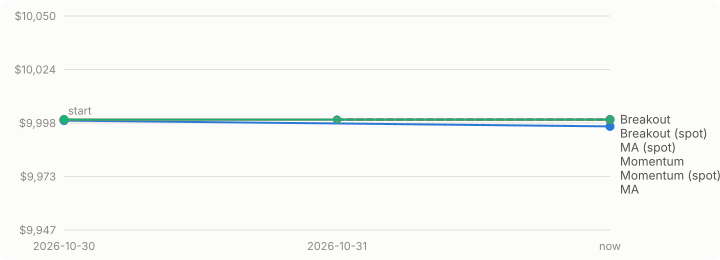

# SpikeAI paper trading

_Updated **Fri 13 Nov 2026, 11:50 PKT** (Fri 01:50 ET). Refreshed after every daily run. Paper trading only: no real money._

## Strategy test: MA crossover vs breakout vs momentum

**44 days left** in the evaluation (until 2026-12-27), then the best strategy is kept.  
Each simulated account started with $10,000. Futures: 2x, long and short, $500 margin per trade. Spot: 1x, buy-only, $500 per buy, copied to Alpaca for coins it lists. Both use an 8% stop.

### Futures

| Strategy | Value | Return | Below peak | Open | Closed (won) | Fees | Funding |
|---|--:|--:|--:|--:|--:|--:|--:|
| 🔵 MA crossover 20/50 | **$10,505.69** | +5.06% | at peak | 4 | 0 | $1.80 | +$2.17 |
| 🟠 Breakout 20/10 | **$10,869.70** | +8.70% | at peak | 13 | 3 (0) | $8.63 | +$8.03 |
| 🟢 Momentum 14d, 5 long/5 short | **$10,143.86** | +1.44% | −1.47% | 6 | 11 (3) | $12.24 | −$0.24 |

**Futures leader:** 🟠 Breakout 20/10, $364.01 ahead of MA crossover 20/50.

### Spot

| Strategy | Value | Return | Below peak | Held | Closed (won) | Fees | On Alpaca |
|---|--:|--:|--:|--:|--:|--:|--:|
| 🔵 MA crossover 20/50 | **$10,000.00** | 0.00% | at peak | 0 | 0 | $0.00 | 0 |
| 🟠 Breakout 20/10 | **$10,000.00** | 0.00% | at peak | 0 | 0 | $0.00 | 0 |
| 🟢 Momentum 14d, 5 long/5 short | **$9,643.96** | −3.56% | −3.56% | 1 | 8 (0) | $20.43 | 0 |

_Spot: no clear leader yet._

_Solid lines = futures, dashed = spot._

Account values as a table

| Date | MA | Breakout | Momentum | MA (spot) | Breakout (spot) | Momentum (spot) |
|---|--:|--:|--:|--:|--:|--:|
| 2026-10-30 | $9,999.54 | $10,000.00 | $10,000.00 | – | – | – |
| 2026-10-31 | $9,988.39 | $9,999.78 | $10,000.00 | $10,000.00 | $10,000.00 | $10,000.00 |
| 2026-11-01 | $10,001.28 | $9,989.21 | $9,994.61 | $10,000.00 | $10,000.00 | $9,992.51 |
| 2026-11-02 | $10,096.92 | $9,967.06 | $10,026.63 | $10,000.00 | $10,000.00 | $9,853.76 |
| 2026-11-03 | $10,000.52 | $9,881.85 | $9,970.65 | $10,000.00 | $10,000.00 | $9,867.56 |
| 2026-11-04 | $9,986.04 | $9,792.20 | $9,920.22 | $10,000.00 | $10,000.00 | $9,861.45 |
| 2026-11-05 | $10,238.48 | $9,996.69 | $10,194.43 | $10,000.00 | $10,000.00 | $9,837.02 |
| 2026-11-06 | $10,220.57 | $9,970.30 | $10,178.96 | $10,000.00 | $10,000.00 | $9,837.64 |
| 2026-11-07 | $10,276.98 | $10,108.40 | $10,188.26 | $10,000.00 | $10,000.00 | $9,834.86 |
| 2026-11-08 | $10,442.05 | $10,440.36 | $10,294.79 | $10,000.00 | $10,000.00 | $9,844.28 |
| 2026-11-09 | $10,397.12 | $10,331.10 | $10,239.06 | $10,000.00 | $10,000.00 | $9,837.31 |
| 2026-11-10 | $10,416.71 | $10,474.48 | $10,101.45 | $10,000.00 | $10,000.00 | $9,752.48 |
| 2026-11-11 | $10,465.16 | $10,591.82 | $10,003.86 | $10,000.00 | $10,000.00 | $9,639.79 |
| 2026-11-12 | $10,502.65 | $10,863.61 | $10,142.84 | $10,000.00 | $10,000.00 | $9,643.96 |
| now | $10,505.69 | $10,869.70 | $10,143.86 | $10,000.00 | $10,000.00 | $9,643.96 |

### Open positions

| Strategy | Coin | Side | Entry → now | Profit | To stop | To liquidation / Alpaca |
|---|---|---|---|--:|--:|--:|
| 🔵 MA | **SUI** | ▼ Short | 0.89681 → 0.78884 | +$120.39 (+24.0%) | ✅ 22.8% | ✅ 62.6% |
| 🔵 MA | **WLD** | ▼ Short | 0.38553 → 0.29634 | +$231.34 (+46.5%) | ✅ 40.5% | ✅ 85.5% |
| 🔵 MA | **NEAR** | ▼ Short | 4.0459 → 3.4586 | +$145.16 (+28.9%) | ✅ 26.3% | ✅ 67.3% |
| 🔵 MA | **ZRO** | ▼ Short | 1.6048 → 1.5913 | +$8.43 (+1.7%) | ✅ 8.9% | ✅ 37.6% |
| 🟠 Breakout | **SOL** | ▼ Short | 91.244 → 79.77 | +$125.75 (+25.1%) | ✅ 23.5% | ✅ 67.5% |
| 🟠 Breakout | **XPL** | ▼ Short | 0.062812 → 0.050171 | +$201.25 (+40.1%) | ✅ 35.2% | ✅ 79.1% |
| 🟠 Breakout | **NEAR** | ▼ Short | 3.6822 → 3.4586 | +$60.72 (+12.1%) | ✅ 15.0% | ✅ 52.2% |
| 🟠 Breakout | **ENA** | ▼ Short | 0.1646 → 0.13712 | +$166.95 (+33.3%) | ✅ 29.6% | ✅ 71.6% |
| 🟠 Breakout | **WLD** | ▼ Short | 0.34441 → 0.29634 | +$139.58 (+28.0%) | ✅ 25.5% | ✅ 65.9% |
| 🟠 Breakout | **XRP** | ▼ Short | 1.1619 → 1.0207 | +$121.53 (+24.3%) | ✅ 22.9% | ✅ 66.7% |
| 🟠 Breakout | **PUMP** | ▼ Short | 0.003674 → 0.003399 | +$74.85 (+14.9%) | ✅ 16.7% | ✅ 54.5% |
| 🟠 Breakout | **SUI** | ▼ Short | 0.81988 → 0.78884 | +$37.86 (+7.6%) | ✅ 12.3% | ✅ 48.5% |
| 🟠 Breakout | **HYPE** | ▼ Short | 71.8649 → 71.655 | +$2.92 (+0.6%) | ✅ 8.3% | ✅ 43.3% |
| 🟠 Breakout | **ZEC** | ▼ Short | 1,003.70 → 942.39 | +$61.08 (+12.2%) | ✅ 15.0% | ✅ 52.2% |
| 🟠 Breakout | **UNI** | ▼ Short | 6.1326 → 5.7823 | +$57.12 (+11.4%) | ✅ 14.5% | ✅ 51.5% |
| 🟠 Breakout | **BNB** | ▼ Short | 632.05 → 632.33 | −$0.44 (−0.1%) | ✅ 8.0% | ✅ 42.8% |
| 🟠 Breakout | **AAVE** | ▼ Short | 111.00 → 111.06 | −$0.51 (−0.1%) | ✅ 7.9% | ✅ 42.8% |
| 🟢 Momentum | **WLD** | ▼ Short | 0.38553 → 0.29634 | +$231.34 (+46.5%) | ✅ 40.5% | ✅ 85.5% |
| 🟢 Momentum | **NEAR** | ▼ Short | 4.202 → 3.4586 | +$176.91 (+35.2%) | ✅ 31.2% | ✅ 73.8% |
| 🟢 Momentum | **HYPE** | ▲ Long | 74.024 → 71.655 | −$32.00 (−6.4%) | ⚠️ 5.0% | ✅ 45.5% |
| 🟢 Momentum | **TRUMP** | ▼ Short | 1.1454 → 1.0749 | +$61.53 (+12.3%) | ✅ 15.1% | ✅ 52.3% |
| 🟢 Momentum | **XPL** | ▼ Short | 0.051503 → 0.050171 | +$25.86 (+5.2%) | ✅ 10.9% | ✅ 46.8% |
| 🟢 Momentum | **ENA** | ▼ Short | 0.14951 → 0.13712 | +$82.88 (+16.6%) | ✅ 17.8% | ✅ 55.8% |
| 🟢 Momentum (spot) | **HYPE** | ▲ Long | 74.1398 → 71.7 | −$18.87 (−3.8%) | ⚠️ 4.9% | 🔴 copy failed |

_Distance = how far the price can still move against the position. ✅ over 5% · ⚠️ 2–5% · 🔴 under 2%. Spot can't be liquidated; its last column shows whether the trade is copied to Alpaca._

### Recent trades

| Time (PKT) | Strategy | Coin | What | Price | Result |
|---|---|---|---|--:|--:|
| Fri 13 Nov, 11:49 | 🟠 Breakout | **BNB** | Opened short | 632.05 | fee $0.45 |
| Fri 13 Nov, 11:49 | 🟠 Breakout | **AAVE** | Opened short | 111.00 | fee $0.45 |
| Thu 12 Nov, 12:16 | 🟠 Breakout | **UNI** | Opened short | 6.1326 | fee $0.45 |
| Thu 12 Nov, 11:00 | 🟢 Momentum | **kPEPE** | Stopped out | 0.0044574 | −$81.03 |
| Thu 12 Nov, 11:00 | 🟢 Momentum (spot) | **PEPE** | Stopped out (Alpaca: stopped on Alpaca) | 0.0000044561 | −$42.30 |
| Thu 12 Nov, 04:00 | 🟢 Momentum | **UNI** | Stopped out | 6.2396 | −$81.07 |
| Thu 12 Nov, 04:00 | 🟢 Momentum (spot) | **UNI** | Stopped out (Alpaca: stopped on Alpaca) | 6.2337 | −$42.30 |
| Wed 11 Nov, 22:00 | 🟠 Breakout | **VVV** | Stopped out | 20.5203 | −$80.45 |
| Wed 11 Nov, 11:29 | 🟠 Breakout | **HYPE** | Opened short | 71.8649 | fee $0.45 |
| Wed 11 Nov, 11:29 | 🟠 Breakout | **ZEC** | Opened short | 1,003.70 | fee $0.45 |
| Wed 11 Nov, 11:29 | 🟠 Breakout | **VVV** | Opened short | 19.0003 | fee $0.45 |
| Tue 10 Nov, 20:00 | 🟢 Momentum | **ZEC** | Stopped out | 1,123.82 | −$80.79 |
| Tue 10 Nov, 20:00 | 🟢 Momentum (spot) | **ZEC** | Stopped out | 1,124.59 | −$42.30 |
| Tue 10 Nov, 15:00 | 🟢 Momentum | **XMR** | Stopped out | 546.31 | −$82.08 |
| Tue 10 Nov, 15:00 | 🟢 Momentum (spot) | **XMR** | Stopped out | 545.98 | −$42.30 |

### Signal board (daily candle of 2026-11-12)

What each strategy sees per coin. 🔔 = the condition for a trade is met.

| Coin | MA: 20d vs 50d | Breakout: vs 20-day range | Momentum: 14d return |
|---|---|---|---|
| **HYPE** | below (−3.9%) | +33.6% to high / −3.3% to low | −18.3% (#15) |
| **ZEC** | below (−4.8%) | +46.3% to high / −0.6% to low | −21.8% (#18) 🔔 bottom 5: short |
| **SOL** | below (−11.1%) | +28.8% to high / −0.5% to low | −14.6% (#11) |
| **NEAR** | below (−12.7%) | 🔔 below 20d low | −15.6% (#13) |
| **XRP** | below (−9.1%) | +29.1% to high / −1.0% to low | −15.9% (#14) |
| **XMR** | above (+4.3%) | +20.5% to high / −1.4% to low | −9.8% (#9) |
| **PUMP** | below (−15.0%) | +34.6% to high / −4.1% to low | −11.7% (#10) |
| **LIT** | below (−9.5%) | +11.1% to high / −20.3% to low | +19.1% (#1) 🔔 top 5: long |
| **kPEPE** | above (+7.5%) | +26.0% to high / −7.1% to low | −0.7% (#3) 🔔 top 5: long |
| **WLD** | below (−19.3%) | +86.9% to high / −0.7% to low | −21.2% (#17) 🔔 bottom 5: short |
| **ENA** | below (−14.4%) | 🔔 below 20d low | −19.9% (#16) 🔔 bottom 5: short |
| **UNI** | below (−9.2%) | 🔔 below 20d low | −6.2% (#7) |
| **TRUMP** | below (−17.4%) | +61.6% to high / −1.8% to low | −28.3% (#19) 🔔 bottom 5: short |
| **XPL** | below (−18.4%) | +72.0% to high / −0.5% to low | −30.9% (#20) 🔔 bottom 5: short |
| **BNB** | below (−3.9%) | 🔔 below 20d low | −5.8% (#6) |
| **SUI** | below (−12.7%) | +24.6% to high / −0.5% to low | −7.4% (#8) |
| **AAVE** | below (−13.0%) | 🔔 below 20d low | −4.4% (#4) 🔔 top 5: long |
| **ZRO** | below (−7.3%) | +25.8% to high / −8.5% to low | +1.9% (#2) 🔔 top 5: long |
| **LINK** | below (−10.7%) | +21.0% to high / −1.3% to low | −4.4% (#5) 🔔 top 5: long |
| **VVV** | below (−9.2%) | +39.0% to high / −3.7% to low | −14.8% (#12) |

_Momentum trades its top/bottom 5 at the Monday rebalance; MA and breakout act at each daily run. Spot uses the same signals but only buys: a short signal just sells what it holds._

### This week's coins (chosen 2026-11-09)

HYPE · ZEC · SOL · NEAR · XRP · XMR · PUMP · LIT · kPEPE · WLD · ENA · UNI · TRUMP · XPL · BNB · SUI · AAVE · ZRO · LINK · VVV

_The 20 most-traded Hyperliquid futures over the past week, excluding BTC and ETH. Refreshed Mondays 00:00 UTC (5:00 AM PKT)._

## Alpaca paper account

Value **$49,600.06** · cash $47,004.76 · account ending YUU8  
Holding: 2 MU (−$305.56), 7e-09 PEPEUSD ($0.00)

**0** simulated spot trade(s) copied and open · 🔴 1 copy error(s): see the spot log. Copies use the same number of coins as the simulation, with a real stop order on Alpaca.

Crypto spot bot: no coins on its watchlist yet (daily 00:15 UTC). Stock bot: stopped.

---
✅ Last run OK · [futures log](logs/futures_bot.log) · [spot log](logs/spot_bot.log) · [project log](PROJECT_LOG.md) · on the PC: `python dashboard.py`

This page is written by summary.py; edits by hand are overwritten.
