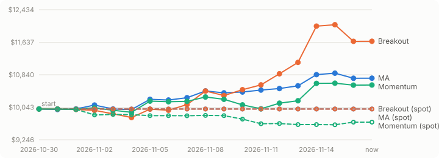

# SpikeAI paper trading

_Updated **Mon 23 Nov 2026, 12:45 PKT** (Mon 02:45 ET). Refreshed after every daily run. Paper trading only: no real money._

## Strategy test: MA crossover vs breakout vs momentum

**34 days left** in the evaluation (until 2026-12-27), then the best strategy is kept.  
Each simulated account started with $10,000. Futures: 2x, long and short, $500 margin per trade. Spot: 1x, buy-only, $500 per buy, copied to Alpaca for coins it lists. Both use an 8% stop.

### Futures

| Strategy | Value | Return | Below peak | Open | Closed (won) | Fees | Funding |
|---|--:|--:|--:|--:|--:|--:|--:|
| 🔵 MA crossover 20/50 | **$11,088.71** | +10.89% | −3.15% | 5 | 1 (1) | $3.03 | −$0.54 |
| 🟠 Breakout 20/10 | **$12,722.76** | +27.23% | −7.39% | 19 | 7 (2) | $14.82 | +$8.06 |
| 🟢 Momentum 14d, 5 long/5 short | **$10,872.38** | +8.72% | −1.20% | 5 | 20 (6) | $19.48 | −$8.71 |

**Futures leader:** 🟠 Breakout 20/10, $1,634.05 ahead of MA crossover 20/50.

### Spot

| Strategy | Value | Return | Below peak | Held | Closed (won) | Fees | On Alpaca |
|---|--:|--:|--:|--:|--:|--:|--:|
| 🔵 MA crossover 20/50 | **$10,000.00** | 0.00% | at peak | 0 | 0 | $0.00 | 0 |
| 🟠 Breakout 20/10 | **$10,020.90** | +0.21% | at peak | 1 | 0 | $1.25 | 0 |
| 🟢 Momentum 14d, 5 long/5 short | **$9,635.59** | −3.64% | −3.64% | 5 | 12 (0) | $35.02 | 2 |

**Spot leader:** 🟠 Breakout 20/10, $20.90 ahead of MA crossover 20/50.

_Solid lines = futures, dashed = spot._

Account values as a table

| Date | MA | Breakout | Momentum | MA (spot) | Breakout (spot) | Momentum (spot) |
|---|--:|--:|--:|--:|--:|--:|
| 2026-10-30 | $9,999.54 | $10,000.00 | $10,000.00 | – | – | – |
| 2026-10-31 | $9,988.39 | $9,999.78 | $10,000.00 | $10,000.00 | $10,000.00 | $10,000.00 |
| 2026-11-01 | $10,001.28 | $9,989.21 | $9,994.61 | $10,000.00 | $10,000.00 | $9,992.51 |
| 2026-11-02 | $10,096.92 | $9,967.06 | $10,026.63 | $10,000.00 | $10,000.00 | $9,853.76 |
| 2026-11-03 | $10,000.52 | $9,881.85 | $9,970.65 | $10,000.00 | $10,000.00 | $9,867.56 |
| 2026-11-04 | $9,986.04 | $9,792.20 | $9,920.22 | $10,000.00 | $10,000.00 | $9,861.45 |
| 2026-11-05 | $10,238.48 | $9,996.69 | $10,194.43 | $10,000.00 | $10,000.00 | $9,837.02 |
| 2026-11-06 | $10,220.57 | $9,970.30 | $10,178.96 | $10,000.00 | $10,000.00 | $9,837.64 |
| 2026-11-07 | $10,276.98 | $10,108.40 | $10,188.26 | $10,000.00 | $10,000.00 | $9,834.86 |
| 2026-11-08 | $10,442.05 | $10,440.36 | $10,294.79 | $10,000.00 | $10,000.00 | $9,844.28 |
| 2026-11-09 | $10,397.12 | $10,331.10 | $10,239.06 | $10,000.00 | $10,000.00 | $9,837.31 |
| 2026-11-10 | $10,416.71 | $10,474.48 | $10,101.45 | $10,000.00 | $10,000.00 | $9,752.48 |
| 2026-11-11 | $10,465.16 | $10,591.82 | $10,003.86 | $10,000.00 | $10,000.00 | $9,639.79 |
| 2026-11-12 | $10,502.65 | $10,863.61 | $10,142.84 | $10,000.00 | $10,000.00 | $9,643.96 |
| 2026-11-13 | $10,569.20 | $11,143.10 | $10,203.16 | $10,000.00 | $10,000.00 | $9,619.33 |
| 2026-11-14 | $10,842.64 | $12,031.38 | $10,629.43 | $10,000.00 | $10,000.00 | $9,619.33 |
| 2026-11-15 | $10,879.67 | $12,066.42 | $10,633.32 | $10,000.00 | $10,000.00 | $9,614.19 |
| 2026-11-16 | $10,754.52 | $11,659.55 | $10,585.62 | $10,000.00 | $10,000.00 | $9,678.18 |
| 2026-11-17 | $10,822.96 | $11,790.38 | $10,654.51 | $10,000.00 | $10,000.00 | $9,820.39 |
| 2026-11-18 | $10,770.65 | $11,796.49 | $10,712.06 | $10,000.00 | $10,000.00 | $9,874.21 |
| 2026-11-19 | $11,045.66 | $12,571.77 | $10,718.62 | $10,000.00 | $10,000.00 | $9,759.36 |
| 2026-11-20 | $11,449.50 | $13,737.30 | $10,920.02 | $10,000.00 | $10,000.00 | $9,645.85 |
| 2026-11-21 | $11,254.31 | $13,278.13 | $11,004.09 | $10,000.00 | $9,998.52 | $9,612.09 |
| 2026-11-22 | $11,083.23 | – | – | $10,000.00 | $10,021.08 | $9,635.59 |
| now | $11,088.71 | $12,722.76 | $10,872.38 | $10,000.00 | $10,020.90 | $9,635.59 |

### Open positions

| Strategy | Coin | Side | Entry → now | Profit | To stop | To liquidation / Alpaca |
|---|---|---|---|--:|--:|--:|
| 🔵 MA | **WLD** | ▼ Short | 0.38553 → 0.23709 | +$385.03 (+78.2%) | ✅ 75.6% | ✅ 131.1% |
| 🔵 MA | **NEAR** | ▼ Short | 4.0459 → 3.0143 | +$254.97 (+50.7%) | ✅ 45.0% | ✅ 92.1% |
| 🔵 MA | **ZRO** | ▼ Short | 1.6048 → 1.2137 | +$243.72 (+48.5%) | ✅ 42.8% | ✅ 80.7% |
| 🔵 MA | **XMR** | ▼ Short | 479.04 → 501.69 | −$47.28 (−9.4%) | ⚠️ 3.1% | ✅ 30.3% |
| 🔵 MA | **kPEPE** | ▼ Short | 0.0034219 → 0.003422 | −$0.03 (−0.0%) | ✅ 8.0% | ✅ 42.9% |
| 🟠 Breakout | **SOL** | ▼ Short | 91.244 → 72.046 | +$210.40 (+42.0%) | ✅ 36.8% | ✅ 85.4% |
| 🟠 Breakout | **NEAR** | ▼ Short | 3.6822 → 3.0143 | +$181.39 (+36.1%) | ✅ 31.9% | ✅ 74.8% |
| 🟠 Breakout | **ENA** | ▼ Short | 0.1646 → 0.10327 | +$372.60 (+74.2%) | ✅ 72.1% | ✅ 128.1% |
| 🟠 Breakout | **WLD** | ▼ Short | 0.34441 → 0.23709 | +$311.61 (+63.2%) | ✅ 56.9% | ✅ 106.5% |
| 🟠 Breakout | **XRP** | ▼ Short | 1.1619 → 0.93737 | +$193.24 (+38.6%) | ✅ 33.9% | ✅ 81.4% |
| 🟠 Breakout | **PUMP** | ▼ Short | 0.003674 → 0.002586 | +$296.14 (+59.0%) | ✅ 53.4% | ✅ 103.2% |
| 🟠 Breakout | **SUI** | ▼ Short | 0.81988 → 0.66718 | +$186.25 (+37.4%) | ✅ 32.7% | ✅ 75.4% |
| 🟠 Breakout | **HYPE** | ▼ Short | 71.8649 → 62.802 | +$126.11 (+25.1%) | ✅ 23.6% | ✅ 63.7% |
| 🟠 Breakout | **ZEC** | ▼ Short | 1,003.70 → 786.78 | +$216.12 (+43.0%) | ✅ 37.8% | ✅ 82.6% |
| 🟠 Breakout | **UNI** | ▼ Short | 6.1326 → 4.7559 | +$224.49 (+44.9%) | ✅ 39.3% | ✅ 84.2% |
| 🟠 Breakout | **BNB** | ▼ Short | 632.05 → 556.97 | +$118.79 (+23.7%) | ✅ 22.6% | ✅ 62.2% |
| 🟠 Breakout | **AAVE** | ▼ Short | 111.00 → 97.798 | +$118.96 (+23.8%) | ✅ 22.6% | ✅ 62.2% |
| 🟠 Breakout | **XMR** | ▼ Short | 490.83 → 501.69 | −$22.12 (−4.4%) | ✅ 5.7% | ✅ 33.5% |
| 🟠 Breakout | **kPEPE** | ▼ Short | 0.003924 → 0.003422 | +$127.93 (+25.6%) | ✅ 23.8% | ✅ 63.8% |
| 🟠 Breakout | **ZRO** | ▼ Short | 1.4562 → 1.2137 | +$166.53 (+33.2%) | ✅ 29.6% | ✅ 63.8% |
| 🟠 Breakout | **AVAX** | ▼ Short | 6.3055 → 6.7165 | −$65.18 (−13.0%) | 🔴 1.4% | ✅ 34.1% |
| 🟠 Breakout | **DOGE** | ▼ Short | 0.053331 → 0.055516 | −$40.97 (−8.2%) | ⚠️ 3.7% | ✅ 37.3% |
| 🟠 Breakout | **GRAM** | ▼ Short | 0.91872 → 1.007 | −$96.09 (−19.3%) | 🔴 -1.5% | ✅ 24.3% |
| 🟠 Breakout | **VVV** | ▲ Long | 24.993 → 26.075 | +$43.29 (+8.7%) | ✅ 11.8% | ✅ 42.5% |
| 🟢 Momentum | **WLD** | ▼ Short | 0.38553 → 0.23709 | +$385.03 (+78.2%) | ✅ 75.6% | ✅ 131.1% |
| 🟢 Momentum | **ENA** | ▼ Short | 0.14951 → 0.10327 | +$309.29 (+61.6%) | ✅ 56.4% | ✅ 107.1% |
| 🟢 Momentum | **VVV** | ▲ Long | 20.0544 → 26.075 | +$300.21 (+60.5%) | ✅ 29.2% | ✅ 53.5% |
| 🟢 Momentum | **PUMP** | ▼ Short | 0.00287 → 0.002586 | +$98.95 (+19.8%) | ✅ 19.9% | ✅ 58.6% |
| 🟢 Momentum | **UNI** | ▼ Short | 5.1601 → 4.7559 | +$78.33 (+15.7%) | ✅ 17.2% | ✅ 55.0% |
| 🟠 Breakout (spot) | **VVV** | ▲ Long | 24.9223 → 26.029 | +$19.60 (+3.9%) | ✅ 11.9% | not on Alpaca |
| 🟢 Momentum (spot) | **VVV** | ▲ Long | 20.0503 → 26.029 | +$145.85 (+29.2%) | ✅ 29.1% | not on Alpaca |
| 🟢 Momentum (spot) | **XRP** | ▲ Long | 0.9366 → 0.93647 | −$2.57 (−0.5%) | ✅ 8.0% | ✅ copied |
| 🟢 Momentum (spot) | **HYPE** | ▲ Long | 62.8598 → 62.85 | −$2.57 (−0.5%) | ✅ 8.0% | 🔴 copy failed |
| 🟢 Momentum (spot) | **LINK** | ▲ Long | 8.9148 → 8.91 | −$2.77 (−0.6%) | ✅ 8.0% | ✅ copied |
| 🟢 Momentum (spot) | **XPL** | ▲ Long | 0.0454 → 0.0455 | −$1.40 (−0.3%) | ✅ 8.2% | not on Alpaca |

_Distance = how far the price can still move against the position. ✅ over 5% · ⚠️ 2–5% · 🔴 under 2%. Spot can't be liquidated; its last column shows whether the trade is copied to Alpaca._

### Recent trades

| Time (PKT) | Strategy | Coin | What | Price | Result |
|---|---|---|---|--:|--:|
| Mon 23 Nov, 12:45 | 🟢 Momentum (spot) | **XRP** | Bought | 0.9366 | fee $1.25 |
| Mon 23 Nov, 12:45 | 🟢 Momentum (spot) | **HYPE** | Bought | 62.8598 | fee $1.25 |
| Mon 23 Nov, 12:45 | 🟢 Momentum (spot) | **LINK** | Bought | 8.9148 | fee $1.25 |
| Mon 23 Nov, 12:45 | 🟢 Momentum (spot) | **XPL** | Bought | 0.0454 | fee $1.25 |
| Mon 23 Nov, 12:44 | 🔵 MA | **SUI** | Closed | 0.66734 | +$255.80 |
| Mon 23 Nov, 12:44 | 🔵 MA | **kPEPE** | Opened short | 0.0034219 | fee $0.45 |
| Sun 22 Nov, 11:54 | 🟠 Breakout | **VVV** | Opened long | 24.993 | fee $0.45 |
| Sun 22 Nov, 11:54 | 🟠 Breakout (spot) | **VVV** | Bought | 24.9223 | fee $1.25 |
| Sat 21 Nov, 20:00 | 🟢 Momentum (spot) | **LIT** | Stopped out | 0.070261 | −$42.30 |
| Sat 21 Nov, 12:14 | 🟠 Breakout | **AVAX** | Opened short | 6.3055 | fee $0.45 |
| Sat 21 Nov, 12:14 | 🟠 Breakout | **DOGE** | Opened short | 0.053331 | fee $0.45 |
| Sat 21 Nov, 12:14 | 🟠 Breakout | **GRAM** | Opened short | 0.91872 | fee $0.45 |
| Fri 20 Nov, 23:00 | 🟢 Momentum | **GRAM** | Stopped out | 0.96735 | −$79.79 |
| Fri 20 Nov, 21:00 | 🟢 Momentum | **BNB** | Stopped out | 542.71 | −$81.10 |
| Fri 20 Nov, 21:00 | 🟢 Momentum (spot) | **BNB** | Stopped out | 542.63 | −$42.30 |

### Signal board (daily candle of 2026-11-22)

What each strategy sees per coin. 🔔 = the condition for a trade is met.

| Coin | MA: 20d vs 50d | Breakout: vs 20-day range | Momentum: 14d return |
|---|---|---|---|
| **HYPE** | below (−8.8%) | +41.2% to high / −11.6% to low | −15.3% (#4) 🔔 top 5: long |
| **ZEC** | below (−10.9%) | +74.2% to high / −14.8% to low | −34.1% (#20) 🔔 bottom 5: short |
| **SOL** | below (−15.9%) | +38.8% to high / −8.2% to low | −18.3% (#9) |
| **XRP** | below (−14.2%) | +44.6% to high / −7.3% to low | −16.5% (#5) 🔔 top 5: long |
| **NEAR** | below (−20.0%) | +45.8% to high / −14.6% to low | −16.8% (#6) |
| **LIT** | below (−5.4%) | +49.0% to high / −10.0% to low | −21.5% (#12) |
| **XMR** | below (−3.1%) | +30.9% to high / −14.7% to low | −17.4% (#8) |
| **PUMP** | below (−22.5%) | +75.5% to high / −16.0% to low | −26.2% (#16) 🔔 bottom 5: short |
| **VVV** | below (−8.7%) | 🔔 above 20d high | +32.8% (#1) 🔔 top 5: long |
| **kPEPE** | below (−0.3%) 🔔 crossed down | +66.1% to high / −6.4% to low | −31.5% (#18) 🔔 bottom 5: short |
| **AAVE** | below (−15.6%) | +39.7% to high / −7.1% to low | −22.3% (#13) |
| **UNI** | below (−12.8%) | +67.0% to high / −10.7% to low | −31.0% (#17) 🔔 bottom 5: short |
| **ENA** | below (−23.9%) | +88.1% to high / −11.3% to low | −31.9% (#19) 🔔 bottom 5: short |
| **DOGE** | below (−13.8%) | +41.6% to high / −8.2% to low | −19.7% (#11) |
| **WLD** | below (−28.9%) | +69.5% to high / −11.9% to low | −24.0% (#15) |
| **BNB** | below (−8.9%) | +29.3% to high / −10.0% to low | −18.3% (#10) |
| **ZRO** | below (−14.2%) | +63.7% to high / −11.1% to low | −23.1% (#14) |
| **LINK** | below (−12.9%) | +33.8% to high / −9.8% to low | −15.3% (#3) 🔔 top 5: long |
| **ADA** | below (−17.1%) | +39.3% to high / −7.9% to low | −17.3% (#7) |
| **XPL** | below (−26.0%) | +60.7% to high / −10.5% to low | −13.0% (#2) 🔔 top 5: long |

_Momentum trades its top/bottom 5 at the Monday rebalance; MA and breakout act at each daily run. Spot uses the same signals but only buys: a short signal just sells what it holds._

### This week's coins (chosen 2026-11-23)

HYPE · ZEC · SOL · XRP · NEAR · LIT · XMR · PUMP · VVV · kPEPE · AAVE · UNI · ENA · DOGE · WLD · BNB · ZRO · LINK · ADA · XPL

_The 20 most-traded Hyperliquid futures over the past week, excluding BTC and ETH. Refreshed Mondays 00:00 UTC (5:00 AM PKT)._

## Alpaca paper account

Value **$49,252.95** · cash $45,449.84 · account ending YUU8  
Holding: 55.9462 LINKUSD (−$0.69), 2 MU (−$608.02), 7e-09 PEPEUSD ($0.00), 532.511 XRPUSD (+$1.43)

**2** simulated spot trade(s) copied and open · 🔴 1 copy error(s): see the spot log. Copies use the same number of coins as the simulation, with a real stop order on Alpaca.

Crypto spot bot: no coins on its watchlist yet (daily 00:15 UTC). Stock bot: stopped.

---
❌ **Last run failed:** see the log · [futures log](logs/futures_bot.log) · [spot log](logs/spot_bot.log) · [project log](PROJECT_LOG.md) · on the PC: `python dashboard.py`

This page is written by summary.py; edits by hand are overwritten.
